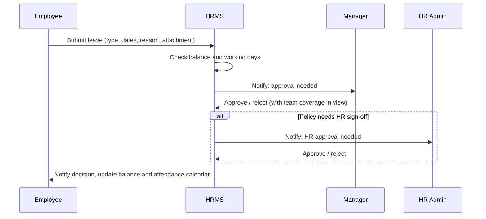
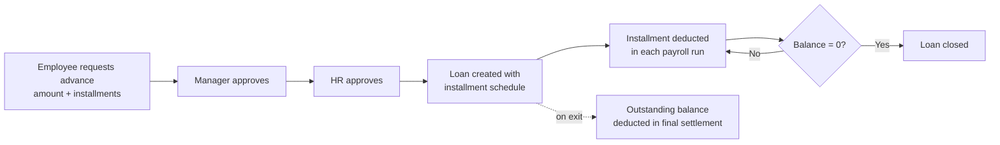
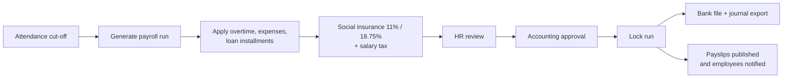
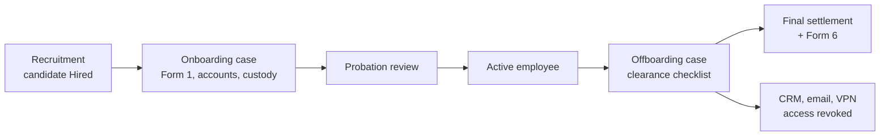
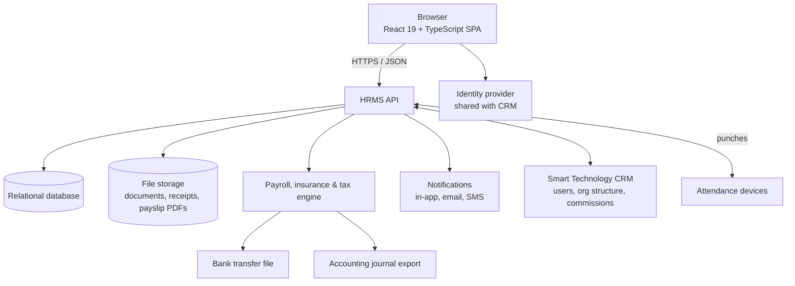

# Product Requirements Document: Smart Technology HRMS

| | |
| --- | --- |
| **Product** | Smart Technology HRMS (the people module beside the Smart Technology CRM) |
| **Document version** | 1.0 (describes the finished product, v1.0 GA) |
| **Date** | October 15, 2026 |
| **Status** | Approved scope. The interactive prototype (this repository) is complete. Backend build follows the release plan below. |
| **Prototype** | [Live demo on GitHub Pages](https://mr-h12.github.io/HRMS-DEMO/) · source in this repository |
| **Related product** | [Smart Technology CRM](https://github.com/mr-h12/smart-technology-CRM) |

---

## 1. Overview

Smart Technology is an Egyptian company with **248 employees** across seven departments: Construction (70), Sales (64), Solar Energy (44), Procurement (22), Administration & IT (20), Accounting (18) and Human Resources (10). People work at **Cairo HQ, the warehouse, construction sites, solar sites and in the field**. The working week is **Sunday to Thursday**, and everyone is paid in **EGP**.

Sales and Procurement already run on the Smart Technology CRM. HR still runs on spreadsheets, paper forms, WhatsApp messages and email. The **Smart Technology HRMS** replaces those with one Arabic-first system that covers the whole employee lifecycle, from job applicant to final settlement. It shares the CRM's look, identity and conventions.

### 1.1 Problem statement

- **Requests get lost.** Leave, overtime, expense, HR-letter and salary-advance requests travel by message or paper. Nobody can see where a request is, and managers approve without seeing team coverage.
- **Payroll is manual and risky.** Each month HR assembles attendance, overtime, loan installments, social insurance and salary tax in spreadsheets. Errors are found after people are paid.
- **Compliance dates are missed.** Contract end dates, probation reviews, ID and permit expiries and social insurance forms (Form 1, 2, 6) are tracked by memory.
- **No single employee record.** Personal data, contracts, documents, custody items and performance history live in different files and folders.
- **Leadership has no live view** of headcount, turnover, attendance or payroll cost.

### 1.2 Vision

> Every Smart Technology employee, manager and HR officer does their HR work in one bilingual system, where each request has an owner, every payroll run reconciles, and no deadline is missed.

---

## 2. Goals, non-goals and success metrics

### 2.1 Goals

1. Give every employee **self-service** for attendance, leave, payslips, documents and requests, in Arabic or English, on desktop and phone.
2. Give managers **one approvals inbox** with the team context they need to decide.
3. Give HR a **single system of record** for people, contracts, documents, custody and the full lifecycle (onboarding to offboarding).
4. Run **monthly payroll** in-system, including Egyptian social insurance, salary tax and loan recovery, and export bank and authority files.
5. Give leadership **live dashboards and reports** on workforce, attendance, turnover and payroll cost.
6. **Integrate with the CRM**: one identity, shared org structure, and access revoked on exit.

### 2.2 Non-goals (v1.0)

- A general ledger or full accounting system (payroll exports a journal to Accounting instead).
- Publishing jobs to external job boards (recruitment tracks candidates from any source).
- Building or selling attendance hardware (we integrate with the devices Smart Technology already uses).
- Multi-company or multi-currency payroll.
- A native mobile app (v1.0 is a responsive web app; native apps may follow).

### 2.3 Success metrics (measured 3 months after GA)

| Metric | Baseline (today) | Target |
| --- | --- | --- |
| Employees who signed in at least once a month | 0% | ≥ 90% |
| Requests submitted in-system (vs. paper or message) | 0% | ≥ 95% |
| Median time from leave request to decision | ~3 days | < 1 working day |
| Time for HR to run monthly payroll | ~4 working days | < 1 working day |
| Payroll corrections after payment | several per month | ≤ 1 per month |
| Contract, probation or document deadlines missed | not tracked | 0 |
| Leavers whose CRM and email access was revoked by the last working day | not tracked | 100% |

---

## 3. Users and personas

| Persona | Role in the system | Needs |
| --- | --- | --- |
| **Ahmed Hassan**, Senior Sales Engineer, Indoor Sales (EMP-1042) | **Employee** | Clock in from the office or the field, check leave balance, request leave or a salary advance, download payslips and HR letters, see his custody items and goals. |
| **Mohamed Ali**, Sales Team Leader, team of 18 (EMP-1008) | **Manager** (the CRM's Team Leader role) | See who is in, late or on leave today; approve or reject requests with coverage in view; track team performance; pull team reports. |
| **Mariam Hassan**, HR Manager, company-wide (EMP-1003) | **HR Admin** | Maintain employee records, run onboarding and offboarding, manage leave policy, run payroll, file social insurance and tax, recruit, track assets and documents, report to leadership. |
| Accounting team | Payroll reviewer (secondary) | Review and approve the payroll run, receive the bank file and journal export. |
| General Manager / executives | Read-only executive (secondary) | Headcount, turnover, attendance and payroll-cost dashboards. |
| IT administrator | System admin (secondary) | SSO, user provisioning, CRM integration, audit logs, backups. |

---

## 4. Product scope and requirements

Priorities: **P0** is required for GA, **P1** is expected for GA and may slip one release, **P2** is a later enhancement.
Every screen listed here is already designed and clickable in the prototype; the requirements describe the finished, data-backed behaviour.

### 4.1 Cross-cutting

| ID | Requirement | Priority |
| --- | --- | --- |
| X-1 | Single sign-on shared with the CRM. A user's role (Employee, Manager, HR Admin, plus secondary roles) comes from their employee record. | P0 |
| X-2 | Role-based access: each role sees only its navigation, pages, data scope and actions. Managers see only their reporting line; employees see only themselves. | P0 |
| X-3 | Full **English / Arabic** interface with right-to-left layout, Arabic date formatting and translated names, labels, notifications and charts. Language choice is remembered per user. | P0 |
| X-4 | In-app **notifications** for every workflow event (submitted, approved, rejected, due soon), with optional email. | P0 |
| X-5 | **Global search** (⌘K / Ctrl+K) across employees, pages and requests, limited to what the user may see. | P1 |
| X-6 | Light and dark theme. | P1 |
| X-7 | Responsive layout that works on a phone for field and site staff. | P0 |
| X-8 | Audit log of every create, update, approval and export, with actor and timestamp. | P0 |
| X-9 | SMS or WhatsApp notifications for staff without company email. | P2 |

### 4.2 Employee self-service

| ID | Requirement | Priority |
| --- | --- | --- |
| E-1 | **Dashboard** with greeting, today's attendance, leave balances, recent requests, upcoming events (holidays, birthdays, reviews) and quick actions. | P0 |
| E-2 | **Clock in / clock out** from the browser, recording time and (for field staff) location. | P0 |
| E-3 | **Attendance calendar** showing present, late, absent, overtime, on leave, missing punch, weekends and public holidays, with monthly hours. | P0 |
| E-4 | **Leave**: balances by type (Annual, Sick, Emergency, Unpaid, Parental), request with dates and optional attachment, working-day count that skips Fridays, Saturdays and holidays. | P0 |
| E-5 | **Requests**: Overtime, Expense (with receipt), HR Letter (salary certificate, employment letter, etc.) and Salary Advance (amount and number of installments). Track status of all own requests. | P0 |
| E-6 | **Payslips**: view each month's earnings and deductions, download as PDF. | P0 |
| E-7 | **Documents**: view and download own documents, upload new ones (ID, certificates). | P0 |
| E-8 | **Custody**: see company assets assigned to me. | P1 |
| E-9 | **Performance**: goals, ratings history and review feedback. | P1 |
| E-10 | **Profile & preferences**: personal and job details, language, theme, notification settings. Changes to personal data go to HR for approval. | P1 |

### 4.3 Manager

| ID | Requirement | Priority |
| --- | --- | --- |
| M-1 | **Dashboard** with team KPIs (present today, on leave, pending approvals, average rating), 7-day attendance chart and the approval queue. | P0 |
| M-2 | **Approvals inbox** for all request types from the reporting line, with request detail, team coverage for the dates, approve / reject with comment, and bulk actions. | P0 |
| M-3 | **My Team** table with filters (status, team, location) and an employee detail drawer. | P0 |
| M-4 | **Team attendance** and **team leave calendar**. | P0 |
| M-5 | **Team performance**: ratings, goals and trend. | P1 |
| M-6 | **Reports** for the team (attendance, leave, performance) with CSV export. | P1 |
| M-7 | **Org chart** of the company. | P1 |
| M-8 | Delegation of approvals while the manager is on leave. | P2 |

### 4.4 HR Admin: People

| ID | Requirement | Priority |
| --- | --- | --- |
| H-1 | **HR dashboard**: headcount, new hires, exits, turnover, attendance today, pending items, 12-month headcount trend, department distribution, recent activity. | P0 |
| H-2 | **Employees**: searchable, filterable directory (department, team, location, status, type) with full employee profile. | P0 |
| H-3 | **Add employee** wizard in 5 steps (personal, job, compensation, documents, review) that creates the employee, their user account and their onboarding case. | P0 |
| H-4 | **Org chart** built from manager relationships, browsable by department. | P1 |
| H-5 | **Contracts & expiries**: contract end dates, probation reviews and expiring documents grouped as Expired, Expiring in 30 days, Due in 31–90 days, with reminders. | P0 |
| H-6 | **Onboarding**: case per new hire from signed offer to end of probation, with a checklist in three phases (*Before joining*: contract signed; National ID, military status and criminal record; medical check; social insurance Form 1; payroll bank account. *First day*: laptop and custody; email and CRM accounts; site safety induction for site staff; buddy. *First 90 days*: mandatory training, 30- and 60-day check-ins, final probation review). Hiring a candidate in Recruitment opens the case automatically. | P0 |
| H-7 | **Probation review** form (overall rating, manager comments, confirm / extend / end). | P0 |
| H-8 | **Offboarding**: case per leaver (Resignation, End of Contract, Retirement, Termination) with clearance checklist owned by Line Manager, IT, Custody, Finance and HR (handover, exit interview, revoke email/CRM/VPN, return custody, recover loans, close expenses, social insurance Form 6, experience certificate). | P0 |
| H-9 | **Final settlement** calculation: salary to last working day, unused leave encashment, minus outstanding loans and unreturned custody. | P0 |

### 4.5 HR Admin: Time & Leave

| ID | Requirement | Priority |
| --- | --- | --- |
| T-1 | **Company attendance**: daily view by department and location, exceptions (late, absent, missing punch), corrections with reason. | P0 |
| T-2 | Import punches from existing attendance devices. | P1 |
| T-3 | **Leave management**: all requests, HR approval step where policy requires it, balances, accruals and carry-over. | P0 |
| T-4 | Configurable policies: shift start/end, break, late grace period, attendance cut-off, overtime multiplier, work week, public holidays. | P0 |

### 4.6 HR Admin: Pay & Benefits

| ID | Requirement | Priority |
| --- | --- | --- |
| P-1 | **Payroll run** per month: generate from employee pay data, attendance, overtime, approved expenses, loan installments, social insurance and salary tax; review totals (gross, deductions, net); accounting approval; lock and publish payslips. | P0 |
| P-2 | Bank transfer file and accounting journal export. | P0 |
| P-3 | **Salary advances & loans**: approved advances become loans with an installment schedule; installments are deducted in payroll automatically; outstanding balance and recovery per month are tracked. | P0 |
| P-4 | **Social insurance**: insurable wage per employee with the legal minimum and maximum applied; employee share (11%) and company share (18.75%); monthly contribution report. | P0 |
| P-5 | **Insurance forms**: Form 1 (registration) for new hires, Form 2 (wage change), Form 6 (termination) for leavers, generated from the record and tracked to submission. | P0 |
| P-6 | **Salary tax** using the progressive brackets and personal exemption, with a salary calculator showing the bracket-by-bracket breakdown. Rules are configurable by HR because the law changes. | P0 |
| P-7 | Sales commission import from the CRM into payroll. | P2 |

### 4.7 HR Admin: Talent

| ID | Requirement | Priority |
| --- | --- | --- |
| R-1 | **Recruitment**: job openings, candidates by stage (Applied → Screening → Interview → Offer → Hired), source tracking, candidate rating, hiring funnel. | P1 |
| R-2 | Moving a candidate to **Hired** creates the employee and their onboarding case. | P1 |
| R-3 | **Performance**: review cycles, goals, ratings (1–5, bands Exceptional / Exceeds / Meets / Developing), company-wide distribution. | P1 |
| R-4 | **Training**: courses, enrolment, completion, mandatory training tracked into onboarding. | P1 |

### 4.8 HR Admin: Administration

| ID | Requirement | Priority |
| --- | --- | --- |
| A-1 | **Assets & custody**: company equipment, vehicles and site tools, who holds them, value, handover and return. Unreturned items block offboarding clearance. | P0 |
| A-2 | **Documents**: company-wide document library with preview, upload, expiry dates and access control. | P0 |
| A-3 | **Reports**: headcount, turnover, attendance, leave, payroll cost and more, filterable, with charts and CSV/PDF export. | P1 |
| A-4 | **Settings**: company details (legal name, commercial registration, HQ), currency, fiscal year start, pay day, payment bank, HR contact, departments, policies and security settings. | P0 |

---

## 5. Key workflows

### 5.1 Leave request

### 5.2 Salary advance to loan recovery

### 5.3 Monthly payroll

### 5.4 Employee lifecycle

---

## 6. Non-functional requirements

| Area | Requirement |
| --- | --- |
| **Security** | SSO with MFA for HR and Accounting roles; role-based and row-level access; encryption in transit (TLS 1.2+) and at rest; salary and national ID fields visible only to permitted roles; full audit log. |
| **Privacy & compliance** | Comply with Egypt's Personal Data Protection Law (No. 151 of 2020) and the Labour and Social Insurance laws. Data hosted in a region approved by management. Defined retention for ex-employee records. |
| **Performance** | Pages load in under 2 s on a 4G connection; payroll run for 248 employees generates in under 30 s; the system supports at least 1,000 employees without redesign. |
| **Availability** | 99.5% monthly uptime during working hours; daily backups with 30-day retention; tested restore. |
| **Accessibility** | WCAG 2.1 AA, keyboard navigation, screen-reader labels, colorblind-safe charts. |
| **Localization** | Every string available in Arabic and English; RTL layout; Arabic and Gregorian-formatted dates; EGP formatting. |
| **Browsers & devices** | Latest two versions of Chrome, Edge, Safari and Firefox; usable on phones from 360 px wide. |
| **Maintainability** | Typed codebase, linting in CI, automated tests on payroll, insurance and tax calculations. |

---

## 7. Solution architecture (finished product)

The prototype in this repository is the production frontend. The finished product adds the services behind it.

| Layer | Current (prototype) | Finished product |
| --- | --- | --- |
| Frontend | React 19, TypeScript, Vite, Tailwind CSS v4, Radix UI, React Router 7, Recharts, Sonner | Same, with the in-memory store (`src/store/AppStore.tsx`) replaced by API calls |
| Data | Seeded mock data in `src/data/` | Relational database with migrations |
| Auth | Role switcher, no login | SSO shared with the CRM, MFA, sessions |
| Files | Uploads accepted but not stored | Object storage with virus scanning and signed URLs |
| Payroll | Displayed totals | Calculation engine with versioned insurance and tax rules |
| Hosting | GitHub Pages (static) | Managed cloud hosting with CI/CD, staging and production |

---

## 8. Data model (summary)

Core entities, already typed in `src/types/index.ts`:

| Entity | Key fields |
| --- | --- |
| **Employee** | id, name, email, phone, position, department, team, location, employment type, manager, joining date, status (Active, On Leave, Probation, Notice Period), basic salary, rating, gender, date of birth, nationality |
| **AttendanceRecord** | employee, date, status, check-in, check-out, hours |
| **HRRequest** | type (Leave, Overtime, Expense, HR Letter, Salary Advance), employee, manager, status, dates, amount, installments, decision by/at |
| **LeaveBalance** | employee, leave type, used, total |
| **Payslip / PayrollRun** | period, earnings lines, deduction lines, working days, pay date, status |
| **Loan** | employee, principal, installments, schedule, outstanding balance |
| **Contract / EmployeeDocument** | type, start, end, expiry, file |
| **OnboardingCase / OffboardingCase** | employee, phase or separation type, checklist items with owner, dates, settlement |
| **Asset** | type, value, holder, assigned and returned dates |
| **JobOpening / Candidate** | position, stage, source, rating |
| **Notification / AuditEvent** | recipient or actor, event, target, time |

---

## 9. Release plan

| Milestone | Scope | Status |
| --- | --- | --- |
| **M0: Interactive prototype** | All three role experiences, every screen in section 4, cross-role workflows on mock data, English/Arabic with RTL, light/dark, deployed to GitHub Pages | ✅ Done (this repository) |
| **M1: Core HR** | Backend, database, SSO, employee records, add-employee wizard, documents, org chart, settings, audit log, data migration from spreadsheets | Next |
| **M2: Time, leave & requests** | Clock in/out, attendance import, leave policies and balances, all request types, approvals, notifications | Planned |
| **M3: Pay & benefits** | Payroll run, payslips, loans, social insurance and forms, salary tax, bank and journal exports. Run in parallel with the old process for 2 months before go-live. | Planned |
| **M4: Lifecycle & talent** | Onboarding, offboarding and final settlement, contracts and expiries, assets and custody, recruitment, performance, training, reports | Planned |
| **GA (v1.0)** | All P0 and P1 requirements, CRM integration, security review, staff training in Arabic | Planned |

---

## 10. Prototype coverage

What the prototype in this repository demonstrates today, and what the finished product adds:

| Module | Prototype | Needs for production |
| --- | --- | --- |
| Employee self-service (dashboard, attendance, leave, payslips, documents, performance, requests) | ✅ Complete UI and flows | API, persistence, PDF payslips |
| Manager (dashboard, team, approvals, attendance, leave, performance, reports, org chart) | ✅ Complete UI and flows | Real reporting lines, delegation |
| Employees, add-employee wizard, org chart | ✅ | Database, account provisioning |
| Contracts & expiries | ✅ | Scheduled reminders |
| Onboarding & probation review | ✅ | Task owners and reminders |
| Offboarding & final settlement | ✅ | CRM/email access revocation hook |
| Attendance & leave management | ✅ | Device integration, accrual engine |
| Payroll run | ✅ (totals reconcile with row data: EGP 5,962,400 gross, 834,700 deductions, 5,127,700 net) | Calculation engine, approvals, exports |
| Salary advances & loans | ✅ | Automatic payroll deduction |
| Social insurance & tax | ✅ (contributions, forms, calculator) | Verified, versioned legal rules |
| Recruitment, performance, training | ✅ | Persistence, candidate documents |
| Assets & custody, documents, reports, settings | ✅ | File storage, scheduled reports |
| English / Arabic + RTL, light / dark, global search, notifications | ✅ | Email/SMS delivery |
| Authentication & security | ❌ Role switcher only | SSO, MFA, RBAC enforcement, audit log |

---

## 11. Risks, assumptions and open questions

### Risks

| Risk | Mitigation |
| --- | --- |
| Insurance limits and tax brackets change by law | Keep them as dated, versioned rules HR can update; payroll tests per rule set; confirm with the company accountant. |
| Payroll errors at go-live | Two months of parallel runs against the existing spreadsheet before switching. |
| Low adoption by site and field staff | Mobile-first screens, Arabic by default, SMS notifications, short on-site training. |
| Data quality in existing spreadsheets | Migration scripts with validation reports; HR cleans data before M1 go-live. |
| CRM integration delays | Ship with HRMS-owned accounts first; connect SSO and access revocation as soon as the CRM API is ready. |

### Assumptions

- Department heads, salary bands, the `smarttech.com.eg` domain and the company address in the prototype are placeholders and will be replaced with real values.
- The existing attendance devices can export punches (file or API).
- The CRM can share users and org structure through an API.

### Open questions

1. Which leave types need an HR approval step after the manager?
2. Which bank(s) does payroll pay through, and what file format does each require?
3. Should site staff without email sign in with phone number and OTP?
4. Who approves the payroll run in Accounting, and is a second approver required?
5. Where must employee data be hosted to satisfy management and the data protection law?
